# StampApp 取扱説明書

PDFの書類に置いた「マーカー（白黒の四角い目印）」をアプリが自動で見つけ、その場所に電子印鑑（丸い日付印）を押すアプリです。
Word・Excel・Acrobat で作ったPDFでも、紙に印刷してスキャンしたPDFでも使えます。

> **ご利用の前に（免責事項）**
> このアプリは「現状有姿」で提供し、作者はいかなる保証もしません。使ったことで生じた損害について、作者は責任を負いません。法令にもとづく記録・契約・承認の判断に、このアプリだけを用いないでください。

> **この説明書の画面写真とサンプルについて**
> 写真やサンプル書類に出てくる「サンプル商事株式会社」「山田 太郎」などの会社名・人名は、すべて架空のものです。

## 目次

1. [このアプリでできること](#1-このアプリでできること)
2. [用意するもの](#2-用意するもの)
3. [入手と起動](#3-入手と起動)
4. [画面の見かた](#4-画面の見かた)
5. [サンプル書類で試す](#5-サンプル書類で試す)
6. [名前の確定（ロック）](#6-名前の確定ロック)
7. [印鑑の見た目を変える](#7-印鑑の見た目を変える)
8. [自分の書類にマーカーを置く](#8-自分の書類にマーカーを置く)
9. [押印の記録（ログ）](#9-押印の記録ログ)
10. [管理者による名前の変更](#10-管理者による名前の変更)
11. [困ったとき](#11-困ったとき)

---

## 1. このアプリでできること

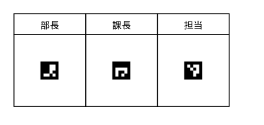

*押印する前の書類。「部長」「課長」「担当」の欄に、それぞれ別の番号のマーカーが置いてあります。*

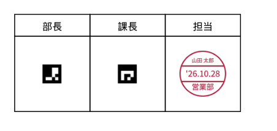

*「担当」の欄（No.1）に押印した後。マーカーが消え、そこに日付印が押されています。*

- マーカーは **No.1〜No.5 の5種類** あります。書類の押印欄ごとに、押す人に合わせて番号を変えて置きます。
- アプリでは「自分の番号」を選ぶだけで、その番号のマーカーがある場所すべてに押印します。何ページあっても一度で押せます。
- 印鑑には **名前・日付・所属（役職）** が入ります。日付は押した日が自動で入ります。
- 押印した記録は、改ざんされていないかを確かめられるログに残ります。

---

## 2. 用意するもの

| もの | 内容 |
|---|---|
| PC | Windows 10 または 11（64bit） |
| 押印したい書類 | PDF。マーカーを置いたもの（置き方は8章） |

Python などを別に入れる必要はありません。

---

## 3. 入手と起動

### 3-1. ダウンロードする

1. GitHub のリポジトリのページを開き、右側の **「Releases」** を押します。
2. いちばん新しい版の **`stamp-app-v（版数）-win64.zip`** を押してダウンロードします。
   - 同じ場所にある「Source code (zip)」は開発用です。選ばないでください。

### 3-2. ブロックを外して展開する

1. ダウンロードした zip を右クリックし、**「プロパティ」** を開きます。
2. 下のほうに「セキュリティ：このファイルは他のコンピューターから取得したものです」と出ていたら、**「許可する」** にチェックを入れて「OK」を押します。
3. zip を右クリックし、**「すべて展開」** を押します。展開先は、デスクトップやドキュメントなど、どこでもかまいません。

### 3-3. 起動する

展開したフォルダの中の **`StampApp` フォルダ → `StampApp.exe`** をダブルクリックします。

- 初めて起動したとき、青い画面で「Windows によって PC が保護されました」と出ることがあります。そのときは **「詳細情報」→「実行」** を押してください。
- `StampApp` フォルダの中のほかのファイルは、アプリが動くのに必要なものです。消したり移したりしないでください。フォルダごとなら、好きな場所に移せます。

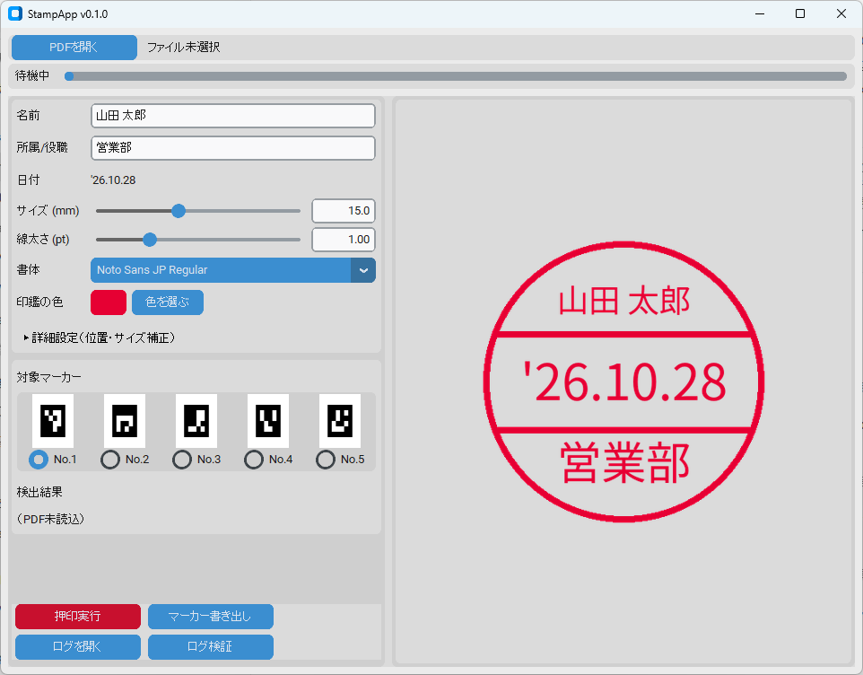

*起動した直後の画面。*

---

## 4. 画面の見かた

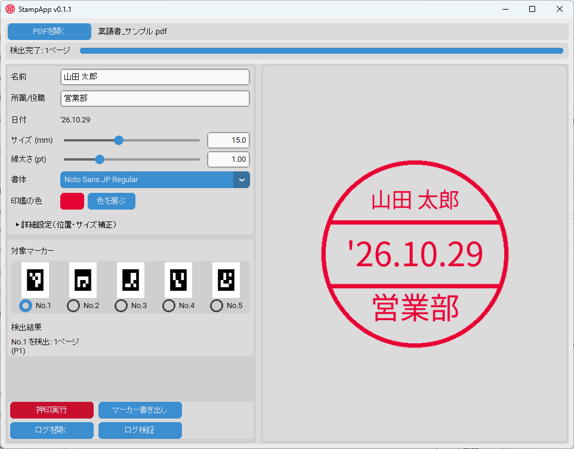

*PDFを開いてマーカーを見つけたところ。*

| 場所 | 内容 |
|---|---|
| いちばん上の題名 | アプリの版数（「StampApp v0.1.0」など）。問い合わせのときに伝えてください |
| 「PDFを開く」 | 押印するPDFを選びます。選ぶとすぐにマーカーを探します |
| 上の細い棒 | 進み具合と、いま何をしているか（「検出完了：1ページ」など） |
| 名前・所属/役職 | 印鑑に入る文字です |
| 日付 | 今日の日付が自動で入ります。変えることはできません |
| サイズ・線太さ・書体・印鑑の色 | 印鑑の見た目です（7章） |
| 対象マーカー | 自分の番号（No.1〜No.5）を選びます |
| 検出結果 | 選んだ番号のマーカーが見つかったページです |
| 「押印実行」 | 押印して、PDFを上書き保存します |
| 「マーカー書き出し」 | 書類に貼るマーカーの画像を書き出します（8章） |
| 「ログを開く」「ログ検証」 | 押印の記録を見る・確かめる（9章） |
| 右側 | 押される印鑑の見本です |

---

## 5. サンプル書類で試す

配布 zip の **`samples` フォルダ** に、練習用の書類が3つ入っています。

| ファイル | 内容 | 置いてあるマーカー |
|---|---|---|
| `稟議書_サンプル.pdf` | 1ページ。部長・課長・担当の押印欄 | 担当 No.1／課長 No.2／部長 No.3 |
| `出張報告書_サンプル.pdf` | 2ページ。両方のページに報告者の欄 | 報告者 No.1（1・2ページ）／確認 No.2 |
| `回覧_サンプル.pdf` | 回覧先5人の押印欄 | 5人それぞれに No.1〜No.5 |

> **押印するとPDFは上書きされます。** 練習するときは、`samples` フォルダのPDFをコピーしてから、コピーのほうで試してください。

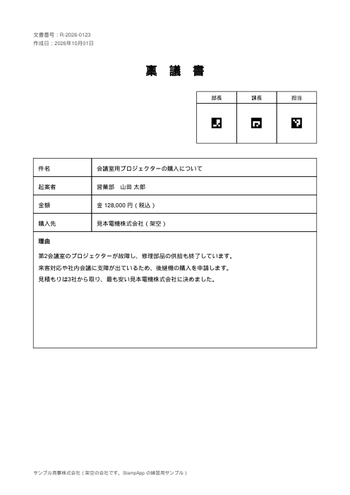

*稟議書のサンプル。右上の3つの欄にマーカーがあります。*

### 5-1. PDFを開く

1. 「PDFを開く」を押し、コピーした `稟議書_サンプル.pdf` を選びます。
2. 上の棒が右端まで進み、「検出完了：1ページ」と出ます。
3. 「対象マーカー」で **No.1** を選んでいることを確かめます。「検出結果」に「No.1 を検出：1ページ（P1）」と出ます。

### 5-2. 名前と所属を入れる

1. 「名前」に自分の名前を入れます。右側の見本がすぐ変わります。
2. 「所属/役職」に部署名や役職を入れます。

> **名前は、最初に押印したときに確定し、そのあと変えられなくなります（6章）。** 間違いがないか、よく確かめてください。

### 5-3. 押印する

1. **「押印実行」** を押します。
2. 初めて押印するときだけ、名前の確定を聞かれます。名前が正しければ「OK」を押します。

   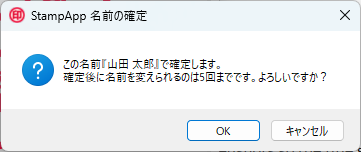

3. 上書きしてよいかを聞かれます。押すページ数を確かめて「OK」を押します。

   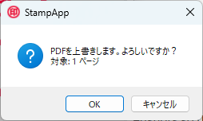

4. 「1ページに押印しました。ログに記録しました。」と出たら完了です。

   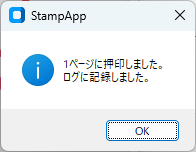

5. 押印後は、アプリがもう一度マーカーを探します。押した場所のマーカーは消えているので、「No.1 を検出：0ページ」になります。

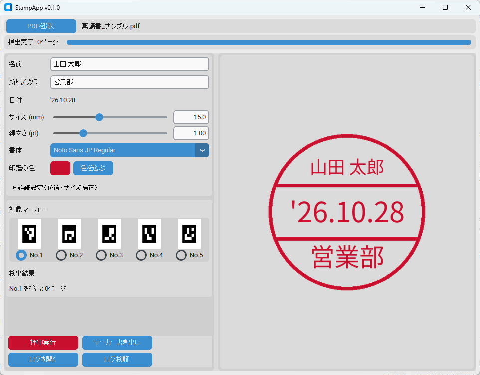

*押印した後の画面。*

PDFを開くと、「担当」の欄に印鑑が押されています。「部長」「課長」の欄（No.3・No.2）は、そのまま残っています。

### 5-4. ほかのサンプルも試す

- **出張報告書**：No.1 を選ぶと「2ページ（P1,2）」と出ます。一度の押印で、両方のページに押されます。
- **回覧**：No.1〜No.5 を順に選び直すと、選んだ番号の欄だけが見つかります。回覧のように、同じ書類を何人かで順番に押すときは、一人ひとりに別の番号を割り当てます。

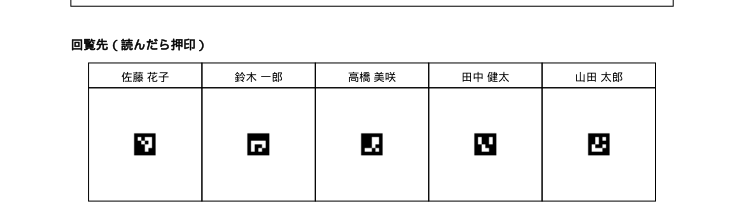

*回覧のサンプル。5人の欄に、それぞれ別の番号のマーカーがあります。*

---

## 6. 名前の確定（ロック）

なりすましを防ぐため、名前は次のように扱います。

- 名前を入れて初めて「押印実行」を押したときに、名前が確定します。
- 確定したあとは、名前の欄は変更できません。所属・色・サイズ・書体は、いつでも変えられます。
- 確定した名前は、このPCの Windows のユーザーごとに記録されます。同じPCでも、別の Windows ユーザーでサインインすれば、別の名前を確定できます。
- 設定ファイルを消しても、名前の確定は解除されません。

名前を変える必要があるときは、10章の手順で管理者に変えてもらいます。

---

## 7. 印鑑の見た目を変える

| 項目 | 内容 |
|---|---|
| サイズ (mm) | 印鑑の直径。5〜30mm。ふつうは 12〜15mm くらいです |
| 線太さ (pt) | 丸と横線の太さ |
| 書体 | Noto Sans JP（Regular・Bold）／ Noto Serif JP（明朝体） |
| 印鑑の色 | 「色を選ぶ」で好きな色にできます。初期は朱色です |

### 詳細設定（位置・サイズ補正）

「▶ 詳細設定（位置・サイズ補正）」を押すと、名前と所属の文字の大きさと上下の位置を細かく直せます。名前が長くて窮屈なときなどに使います。「補正を初期値に戻す」で元に戻ります。

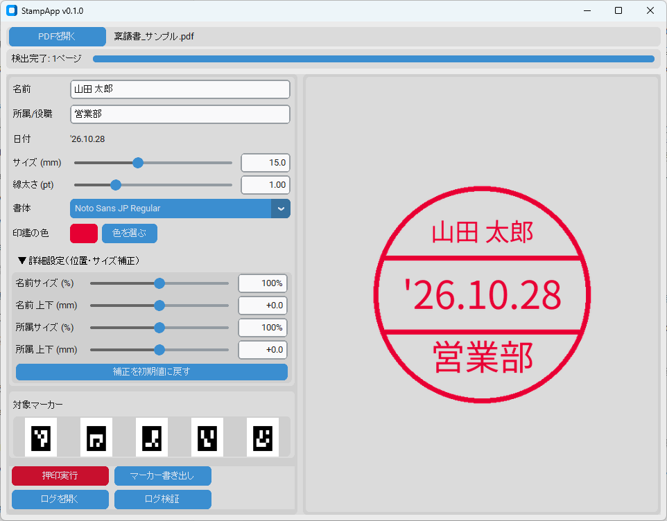

*詳細設定を開いたところ。*

設定は、アプリを閉じたときに自動で保存されます。次に起動したときも同じ設定で始まります。

---

## 8. 自分の書類にマーカーを置く

### 8-1. マーカーを書き出す

1. 「マーカー書き出し」を押し、保存先のフォルダを選びます。
2. 次のファイルができます。

| ファイル | 使いみち |
|---|---|
| `marker_no1.png` 〜 `marker_no5.png` | Word・Excel・Acrobat に貼る画像 |
| `marker_no1.svg` 〜 `marker_no5.svg` | 高精細な画像（Office 2016 以降） |
| `markers_print.pdf` | 印刷用の見本（番号入り） |

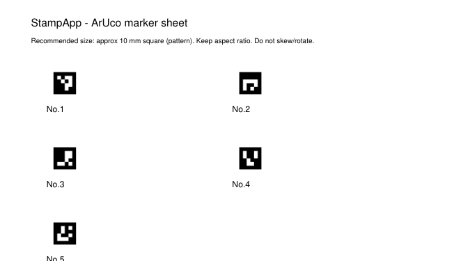

*印刷用の見本（markers_print.pdf）。*

マーカーの画像には、番号を入れていません（押印したあとに番号が残ってしまうため）。どれが何番かは、**ファイル名（marker_no1〜no5）** で見分けます。アプリの「対象マーカー」にも、同じ見本が番号付きで並んでいます。

### 8-2. 書類に貼る

| 作るソフト | 貼り方 |
|---|---|
| Word・Excel | 「挿入」→「画像」→「このデバイス」→ `marker_noX.png`（または SVG）を選ぶ |
| Acrobat | 「編集」→「画像を追加」→ `marker_noX.png` を選ぶ |
| 紙の書類 | `markers_print.pdf` を印刷して切り取り、押印欄に貼ってからスキャンする |

貼ったあとは、次のことに気をつけてください。

- 大きさは **約10mm四方** にします。小さすぎると見つけにくくなります。
- **縦横比を変えない**（つぶさない）、**斜めにしない** でください。
- 押印欄の真ん中に置きます。印鑑はマーカーの中心に押されます。
- Word・Excel でPDFにするときに画像が粗くなる場合は、「ファイル」→「オプション」→「詳細設定」→「ファイル内のイメージを圧縮しない」にチェックを入れます。

---

## 9. 押印の記録（ログ）

押印するたびに、次の内容が **`ドキュメント\StampApp-Public\stamp_log.csv`** に記録されます。

- 押した日時
- PDFの場所とファイル名
- 押したページ
- 名前・日付・所属
- PCの名前（コンピューター名）

それぞれの行には、前の行とつながった「指紋」（ハッシュ）が付いています。あとから行を書き換えたり消したりすると、つながりが合わなくなります。

| ボタン | 内容 |
|---|---|
| ログを開く | ログを Excel などで開きます |
| ログ検証 | ログが書き換えられていないかを確かめます。問題がなければ「ログは改ざんされていません」と出ます |

> **押印したPDFにも記録が入ります。** 押印したPDFの「プロパティ」（文書の情報）に、日時・名前・所属・PCの名前・押したページが書き込まれます。社外に送るPDFでは、このことを知ったうえで使ってください。

---

## 10. 管理者による名前の変更

確定した名前を変えられるのは、**管理者キーワードを知っている人だけ** です。管理者キーワードは、アプリを配った管理者だけが知っています。

1. 次のフォルダに、`admin_override.txt` という名前のテキストファイルを作ります。
   `%LOCALAPPDATA%\StampApp-Public\`
   （エクスプローラーの上の欄にこのとおり入れると、フォルダが開きます）
2. ファイルの中身を、次の2行にします（文字コードは UTF-8）。
   ```
   keyword=（管理者キーワード）
   name=新しい名前
   ```
3. アプリを起動すると、「管理者により名前を変更しました」と出て、名前が変わります。このファイルは自動で消えます。
   キーワードが違うと「管理者キーワードが正しくありません」と出て、名前は変わりません。

> GitHub の Releases で配っている版の管理者キーワードは、公開していません。

---

## 11. 困ったとき

| こんなとき | 確かめること |
|---|---|
| 「検出結果」が0ページになる | 「対象マーカー」の番号が、書類に置いた番号と合っているか。マーカーが小さすぎないか（約10mm）、つぶれたり斜めになったりしていないか |
| 「選択中のマークが検出されませんでした」と出る | 上と同じです。押印済みの書類では、マーカーが消えているので0ページになります |
| スキャンしたPDFで見つからない | 解像度を上げてスキャンし直す。マーカーの上に線や文字が重なっていないか |
| 「PDFを上書きします」のあとでエラーになる | そのPDFを Acrobat などで開いたままにしていないか。閉じてからもう一度押します |
| 名前を変えられない | 6章のとおり、確定後は変えられません。10章の手順で管理者に依頼します |
| 「本人名情報が破損/改ざんされています」と出る | 名前の記録が壊れているため、押印できません。管理者に連絡してください |
| 以前の丸囲み文字（㊎ など）の目印が使えない | 今の版では使えません。8章のマーカーに貼り替えてください |
